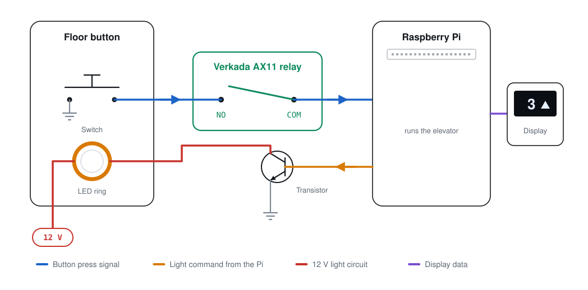
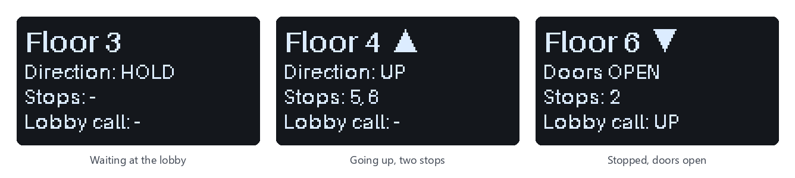

# TinyLift

A tabletop demo elevator for showing off access-control integrations. A Raspberry Pi
simulates a single elevator cab serving six floors. Real 19 mm LED push buttons act as
the floor and lobby call buttons, and a small OLED screen mimics the cab's floor
indicator. Each floor button runs through a relay on an access controller such as the
**Verkada AX11**, so a floor press only counts while that floor is unlocked.



## How it works

1. **Someone presses a floor button.** The button's switch connects its signal wire to ground.
2. **The access controller decides whether the press counts.** The AX11 relay's COM and NO
   contacts only connect while that floor is granted, for example after a badge scan.
   Otherwise the press never reaches the Pi.
3. **The Pi records the call** and moves the virtual cab one floor at a time, stopping at
   each requested floor. It keeps its direction while there are stops ahead, like a real
   elevator.
4. **The button lights up.** The Pi switches on a transistor, which powers the button's
   12 V LED ring. The light goes out when the cab arrives.
5. **The screen follows along**, showing the floor, the direction and the remaining stops.

The two lobby call buttons (UP and DOWN) skip the access controller, so anyone can call
the elevator, as in a real building.



## Hardware

| Part | Qty | Notes |
|---|---|---|
| Raspberry Pi 3B+ | 1 | Any 40-pin Pi should work; the Pi 3B+ is the tested one |
| 19 mm momentary LED push button | 8 | 12–24 V LED ring, 5-wire harness (NO, C, NC, LED, LED) |
| NPN transistor (2N2222 / PN2222A) | 8 | One per button, switches the LED ring |
| Resistor in each LED path | 8 | On the transistor board, between collector and LED |
| 1 kΩ resistor | 8 | In each Pi → transistor base wire (protects the Pi pin) |
| 12 V power supply | 1 | Powers the LED rings; its ground is shared with the Pi |
| 0.96" SSD1306 I2C OLED (128×64) | 1 | Optional. A 16×2 / 20×4 I2C character LCD also works |
| Verkada AX11 (or any dry-contact relay controller) | 1 | Optional. One relay per floor |
| Solderable breadboard, wire | | |

The program runs without the screen and without the access controller. A missing
screen is logged and retried every 30 seconds, and the elevator keeps running.

**Full wiring guide with diagrams: [docs/WIRING.md](docs/WIRING.md).**

## Pins

BCM GPIO number / physical header pin. Every pin can be changed in [`config.py`](config.py).

| Button | Input | LED output |
|---|---|---|
| Floor 1 | GPIO17 / 11 | GPIO18 / 12 |
| Floor 2 | GPIO27 / 13 | GPIO8 / 24 |
| Floor 3 | GPIO9 / 21 | GPIO11 / 23 |
| Floor 4 | GPIO5 / 29 | GPIO25 / 22 |
| Floor 5 | GPIO6 / 31 | GPIO12 / 32 |
| Floor 6 | GPIO13 / 33 | GPIO16 / 36 |
| Call UP | GPIO19 / 35 | GPIO20 / 38 |
| Call DOWN | GPIO26 / 37 | GPIO21 / 40 |

OLED: VCC → pin 1 (3.3 V), GND → pin 6, SDA → pin 3, SCL → pin 5. Breadboard ground → pin 9.

## Install

On the Raspberry Pi (built on Raspberry Pi OS Bullseye with Python 3.9; newer releases should also work):

```bash
git clone https://github.com/FletcherMeyer/tinylift.git ~/tinylift
cd ~/tinylift
bash install.sh
```

`install.sh` installs the libraries, turns on I2C and runs TinyLift from the folder you
cloned. It takes Pillow from Raspberry Pi OS (`python3-pil`) and installs small, pinned,
pure-Python packages, so pip never tries to build Pillow, which fails on a Pi 3.

## Run

```bash
python3 tinylift.py --test     # wiring check: lights each LED in turn, prints every press
python3 tinylift.py            # run the elevator (Ctrl+C to stop)
python3 tinylift.py --no-lcd   # run without the screen
python3 tinylift.py --sim      # no hardware at all: type 1-6, u or d, then Enter
```

Options `--floor-seconds` and `--dwell-seconds` override the travel and door times.
Logs go to the console and to `logs/tinylift.log`.

### Start at boot

```bash
bash install.sh --cron          # start at boot in a terminal window on the Pi's screen
bash install.sh --autostart     # or: start at boot as a background service (no window)
bash install.sh --no-autostart  # turn either one off
```

Use one or the other. Two copies driving the same pins cause phantom presses, so each
option turns the other one off.

## Configuration

Everything you might change lives in [`config.py`](config.py): pins, number of floors,
the lobby floor, travel and door times, and the screen type. Screens are found
automatically by I2C address: 0x3C/0x3D is treated as an OLED, anything else as a
character LCD. For a 1.3" SH1106 OLED set `OLED_DRIVER = "sh1106"`; for an upside-down
screen set `OLED_ROTATE = 2`.

## Files

| File | What it is |
|---|---|
| `tinylift.py` | Main program: buttons, LEDs, display, main loop, `--test` and `--sim` modes |
| `elevator.py` | The elevator logic only, with no hardware code |
| `display.py` | Optional screen: SSD1306/SH1106 OLED or character LCD. Includes a built-in OLED driver used if the `luma.oled` library is unavailable |
| `config.py` | Pins, timings and screen settings |
| `test_elevator.py` | Logic tests: `python3 test_elevator.py` |
| `install.sh` | Installer and start-at-boot setup |
| `start_on_boot.sh`, `tinylift.service` | Used by the two start-at-boot options |
| `docs/` | Wiring guide and images |

## Credits

TinyLift started as [ryanmalley101/tinyLift](https://github.com/ryanmalley101/tinyLift),
a demo elevator for testing access-control relay integrations. This version is a
rewrite: elevator logic separated from the hardware code, with tests; debounced button
polling; an optional, self-recovering display with OLED support; a wiring check mode;
and fixes for a lost floor press while both lobby lamps were lit and for a crash on
shutdown.

## License

[MIT](LICENSE)
