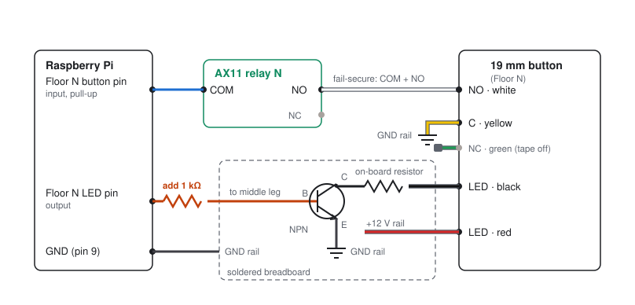
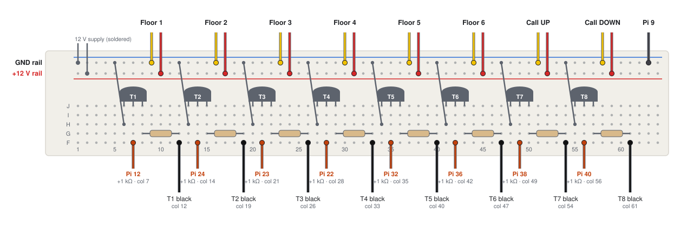
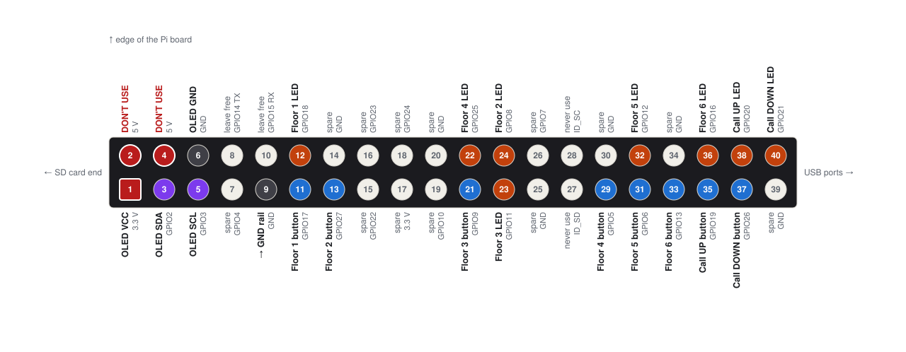
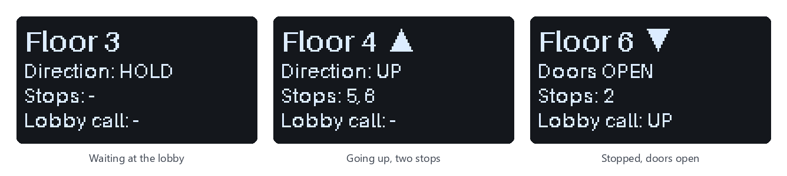

# TinyLift wiring guide

How to wire the buttons, the transistor board, the Raspberry Pi, the access controller
and the screen. Pin numbers in the drawings are **physical header pins** (1–40) unless
they say GPIO.

**Contents**

1. [One button, start to finish](#1-one-button-start-to-finish)
2. [The button's wire colors](#2-the-buttons-wire-colors)
3. [The transistor board](#3-the-transistor-board)
4. [Raspberry Pi pins](#4-raspberry-pi-pins)
5. [Access controller (Verkada AX11)](#5-access-controller-verkada-ax11)
6. [Display](#6-display)
7. [Bring-up checklist](#7-bring-up-checklist)
8. [Troubleshooting](#8-troubleshooting)

## What gets wired

- **Pi to transistor board:** 8 LED signal wires, one to each transistor's middle leg
  with a 1 kΩ resistor inline, plus 1 ground wire.
- **Buttons:** 4 wires per button: NO, C, LED+ and LED−. NC stays unconnected.
- **Access controller:** sits in the signal wire of each of the 6 floor buttons.
- **Display:** 4 wires straight to the Pi. No level shifter is needed.

## 1. One button, start to finish

Every floor button is wired the same way; only the pin numbers change. The two lobby
call buttons are the same except they skip the access controller and go straight to the Pi.



Line colors: **blue** = button signal (3.3 V), **orange** = LED signal from the Pi,
**red** = 12 V, **grey** = ground. The button's wires are drawn in their harness colors.

- **Button signal:** the Pi input uses its internal pull-up, so it reads HIGH until a
  press pulls it LOW through the relay and the button's switch.
- **LED drive:** the Pi pin turns on an NPN transistor (low-side switch). Current flows
  from the +12 V rail through the LED ring and the board's resistor into the collector,
  and out the emitter to ground.
- **Ground:** the Pi's ground must be connected to the board's ground rail (pin 9),
  or the transistors can't switch. **Never connect 12 V to any Pi pin.**

> **Add a 1 kΩ resistor in each Pi → base wire.** The resistor on the board is in the
> LED path, not the base. Without a base resistor the Pi pin pushes more current than
> it's rated for, which can damage it over time. Anything from 470 Ω to 2.2 kΩ works.
> Solder it inline at the Pi end and cover it with heat-shrink.

> **Check the transistor part number.** The board layout expects the leg order E-B-C,
> as on **2N2222** and **PN2222A**. **P2N2222A** parts have the outer legs swapped
> (C-B-E); with those, swap the emitter and collector connections, or the LEDs will be
> very dim or stay off.

## 2. The button's wire colors

Each button comes with a connector harness of 5 colored wires. The ring is rated
12–24 V, so it runs directly from the 12 V rail.

| Wire | Job | Goes to |
|---|---|---|
| White | NO (normally open) | Floor buttons: that floor's relay **NO** contact. Call buttons: straight to their Pi pin |
| Yellow | C (common) | Ground rail |
| Green | NC (normally closed) | Nothing. Tape or heat-shrink the bare end |
| Red | LED | +12 V rail |
| Black | LED | Free end of that channel's resistor |

Red and black are both labeled "LED", and the ring usually works either way round. If a
ring stays dark in `--test`, swap that button's red and black.

**Check one button before wiring all eight.** With a multimeter on continuity:
released, yellow and green beep; held down, yellow and white beep. If not, your harness
colors differ, so go by the beep test, not the colors.

## 3. The transistor board

The LED drivers sit on a solderable breadboard: two rails along the top (ground, then
+12 V) and eight identical channels. In each channel, the transistor's left leg
(emitter) is jumpered to ground, its middle leg (base) takes the Pi wire, and its right
leg (collector) goes to one end of a resistor. The button's black LED wire lands on the
resistor's other end.



Grey parts are soldered to the board. Colored wires are the connections to make:
**orange** = Pi LED pin (through the added 1 kΩ), **black** = button LED−,
**yellow** = button C to the ground rail, **red** = button LED+ to the +12 V rail.
"Pi 12" means physical header pin 12.

- A column of 5 holes is one connected strip, so "col 7" means any free hole in column 7.
- Rail wires can go in any free hole along their rail.
- If your board is laid out differently, go by position: the Pi wire goes to the
  transistor's **middle leg**, and the black wire to the **far end of that channel's resistor**.

| Transistor | Button | Pi LED pin → base | Button white wire → | Pi input pin |
|---|---|---|---|---|
| T1 | Floor 1 | 12 | AX11 relay 1 NO; relay COM → | 11 |
| T2 | Floor 2 | 24 | AX11 relay 2 NO; relay COM → | 13 |
| T3 | Floor 3 | 23 | AX11 relay 3 NO; relay COM → | 21 |
| T4 | Floor 4 | 22 | AX11 relay 4 NO; relay COM → | 29 |
| T5 | Floor 5 | 32 | AX11 relay 5 NO; relay COM → | 31 |
| T6 | Floor 6 | 36 | AX11 relay 6 NO; relay COM → | 33 |
| T7 | Call UP | 38 | direct → | 35 |
| T8 | Call DOWN | 40 | direct → | 37 |

Plus one wire from Pi pin 9 to the ground rail.

## 4. Raspberry Pi pins

Hold the Pi with the 40-pin header along the top edge and the USB ports on the right.
Pin 1 has the square pad, at the bottom left. Odd pins (1, 3 … 39) are the inner row;
even pins (2, 4 … 40) run along the board's edge.



| Button | Input (GPIO / pin) | LED output (GPIO / pin) |
|---|---|---|
| Floor 1 | GPIO17 / 11 | GPIO18 / 12 |
| Floor 2 | GPIO27 / 13 | GPIO8 / 24 |
| Floor 3 | GPIO9 / 21 | GPIO11 / 23 |
| Floor 4 | GPIO5 / 29 | GPIO25 / 22 |
| Floor 5 | GPIO6 / 31 | GPIO12 / 32 |
| Floor 6 | GPIO13 / 33 | GPIO16 / 36 |
| Call UP | GPIO19 / 35 | GPIO20 / 38 |
| Call DOWN | GPIO26 / 37 | GPIO21 / 40 |

Notes on these pins:

- **Serial pins are avoided.** GPIO14/15 (pins 8 and 10) toggle during boot as the
  serial console, so nothing uses them.
- **Keep SPI turned off.** GPIO8, 9 and 11 are the Pi's SPI pins. They work as normal
  pins while SPI is off, which is the Raspberry Pi OS default.
- **The Floor 2 ring may glow faintly while the Pi boots.** GPIO8 is pulled high at
  power-up, until TinyLift starts. This is harmless.
- **Every pin can be changed** in `config.py`. The program refuses to start if two
  settings share a pin.

## 5. Access controller (Verkada AX11)

The AX11 has 16 dry-contact Form C relays (COM / NO / NC). Use relay N for floor N.
Each relay sits in the wire between a floor button and the Pi, so the Pi only sees the
presses the controller allows. No code talks to the AX11.

**Per floor:** Pi input pin → relay **COM**, relay **NO** → button's white wire.

- **COM + NO (fail-secure), as in this build.** A floor button only reaches the Pi while
  the AX11 is granting that floor, for example after a badge scan. Otherwise the press
  is ignored, and if the AX11 loses power every floor is locked.
- **COM + NC (fail-safe) is the alternative.** Buttons work unless the AX11 locks a
  floor, and keep working if it loses power. Verkada recommends fail-safe for elevators
  in real buildings. To switch a floor, move its wire from NO to NC.
- Only the 3.3 V button signal goes through the relay. Never route the 12 V LED wiring
  or a Pi power pin through it.
- The lobby call buttons skip the relays, as hall calls do in real buildings. To control
  them too, use relays 7 and 8 the same way.
- For long relay runs, use shielded cable. The program's 40 ms debounce filters the
  remaining noise.

If a floor sometimes misses presses only when it goes through a relay, add a 1 kΩ
resistor from that Pi input pin to 3.3 V (pin 17). The Pi's internal pull-up passes very
little current, which can be unreliable on large relay contacts.

## 6. Display

A 0.96" SSD1306 OLED (128×64, I2C address 0x3C) runs on 3.3 V. It needs no level
shifter, backlight or contrast adjustment.

| OLED pin | Pi pin |
|---|---|
| VCC | 1 (3.3 V) |
| GND | 6 |
| SDA | 3 (GPIO2) |
| SCL | 5 (GPIO3) |

> **Go by the labels printed on the screen, not by pin position.** Many of these modules
> order their pins GND, VCC, SCL, SDA. Swapping VCC and GND can destroy the screen.



- `install.sh` turns on I2C. To do it by hand: `sudo raspi-config` → Interface Options → I2C.
- Screens are told apart by address: 0x3C/0x3D is an OLED, anything else a character
  LCD. To force one, set `LCD_TYPE = "oled"` or `"char"` in `config.py`.
- Upside down? Set `OLED_ROTATE = 2`. A 1.3" OLED with the SH1106 chip? Set
  `OLED_DRIVER = "sh1106"`.
- A 16×2 or 20×4 character LCD with a PCF8574 I2C backpack also works (usually at 0x27
  or 0x3F). Set its size with `LCD_COLS` and `LCD_ROWS`. Note that most of these run at
  5 V and need a level shifter on SDA/SCL.
- No screen? The program logs that, keeps running, and checks again every 30 seconds.

## 7. Bring-up checklist

1. Install:
   ```bash
   git clone https://github.com/FletcherMeyer/tinylift.git ~/tinylift
   cd ~/tinylift && bash install.sh
   ```
2. Run the wiring check. It lights each LED in turn and names its pin, then prints
   every button press:
   ```bash
   python3 tinylift.py --test
   ```
   Floor presses only appear while the AX11 is granting that floor. The call buttons
   always appear.
3. Run the elevator: `python3 tinylift.py`. Stop it with Ctrl+C.
4. Optional: start it at every boot.
   - `bash install.sh --cron` adds a cron `@reboot` job that opens a terminal window
     titled **TinyLift** on the Pi's screen (or prints to the console on a Pi without
     a desktop). If nothing appears, read `logs/boot.log`.
   - `bash install.sh --autostart` runs it as a background service instead. Follow it
     with `journalctl -u tinylift -f`.
   - `bash install.sh --no-autostart` turns off both.

Shut the Pi down with `sudo shutdown -h now` before unplugging it. Pulling the power
right after installing software can leave files empty on the SD card.

## 8. Troubleshooting

| Log message or symptom | What it means |
|---|---|
| `Button 'Floor 3' … reads PRESSED at startup` | The input is shorted to ground. Usually the button's green NC wire is connected where the white NO wire should be |
| `… has read PRESSED for 10+ s` | A stuck button, or NO and NC swapped |
| A button never shows up in `--test` | Check its wire, the yellow wire's ground, and whether the AX11 is currently granting that floor |
| An LED ring stays dark in `--test` | Swap that button's red and black wires. Check the transistor part number (section 1) and the Pi ground wire |
| `Display not detected on I2C bus 1` | Check the 4 screen wires, or ignore it if no screen is connected. The elevator runs either way |
| `Display connected` but the screen is blank | The wrong screen type was chosen. The log should say `OLED`; if it doesn't, set `LCD_TYPE = "oled"` |
| `Display library missing` | Run `bash install.sh` again |
| `luma.oled library not usable … using TinyLift's built-in OLED driver instead` | Harmless: the screen still works. Run `bash install.sh` to repair the library |
| `smbus2 isn't usable … using the built-in 'smbus' library instead` | Harmless: the screen still works. The message names the file Python found; if it's not inside `site-packages`, rename it. Otherwise run `bash install.sh` |
| Phantom presses or flickering LEDs | Two programs are driving the same pins. Check `crontab -l` and `systemctl status tinylift`, and stop the extra copy |
